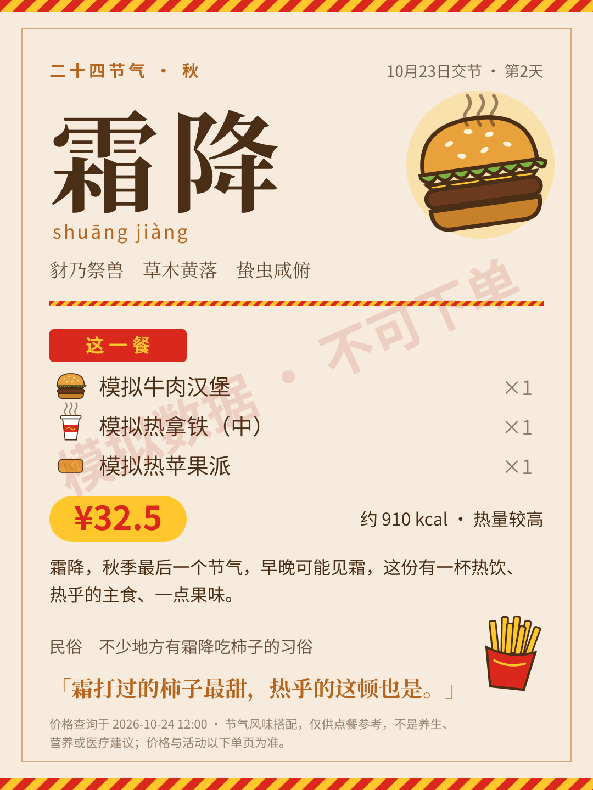

# 麦·节气 · Mai Jie Qi

**二十四节气 × 麦当劳：每个节气，配一顿应景的饭。**

一个在 AI 助手里使用的麦当劳 MCP Skill。它先算出今天是哪个节气、第几天，再从你附近门店的**真实菜单、活动和试算价格**里，按节气的风味方向和你此刻的体感（怕冷、怕热、想清淡、想扛饿……）配一餐，讲一句物候和民俗，最后生成一张可以发朋友圈的节气卡片。

<p align="center"></p>

> 上图为模拟数据生成的示例卡片，餐品名称和价格均为虚构。

## 为什么做这个

麦当劳一年四季都是同一份菜单，但人对“想吃什么”的感觉跟着天气和节气在变：寒露之后想要一杯热的，大暑只想来口冰的，立秋想贴秋膘。麦·节气把这种直觉变成可复现的规则——**节气决定风味方向，MCP 决定能买到什么、多少钱**。

## 试着这样说

| 场景 | 说法 |
|---|---|
| 节气一餐 | “今天什么节气？帮我在公司附近的麦当劳配一顿，35 元以内。” |
| 加上体感 | “有点怕冷，不想吃油炸的。” |
| 提前准备 | “下个节气是什么时候？那几天有什么活动？” |
| 分享 | “把刚才这顿做成节气卡片。” |

## 它怎么工作

1. **算节气**：`solar_term.py` 用天文公式计算太阳视黄经，得出当前节气、交节时刻和下个节气倒计时，不依赖查表，任何年份都能用（与公开历书误差在 10 分钟内）。
2. **查门店**：通过麦当劳 MCP 查门店、菜单、套餐组成、营养、活动日历和门店优惠。
3. **组候选并试算**：助手按风味标签（热饮、冰品、清爽、油炸……）组 4–8 份完整一餐，每份都用 `calculate-price` 试算实付价。
4. **排序**：`pairing.py` 先做硬约束（可售、已试算、预算、忌口、热量上限、活动有效期），再按“节气权重 + 体感权重”打分。约束不满足时不偷偷放宽。
5. **出卡片**：`card.py` 生成 1080×1440 的 SVG 卡片：四季配色打底，加上快餐红黄、托盘纸条纹和手绘风汉堡/薯条盒/饮料杯图标，每样餐品按类型自动配图标；应季热食的节气，汉堡会冒热气。不使用任何品牌 Logo 或官方形象。

24 个节气各自带有七十二候物候、一条民俗、一句卡片小句和风味权重，见 [`data/solar_terms.json`](skills/mai-jie-qi/data/solar_terms.json)。

## 安装

需要支持 Skills 和 Streamable HTTP MCP 的 AI 助手；本地脚本需要 Python 3.9+，只用标准库。

1. 把 `skills/mai-jie-qi` 整个目录放进客户端的 Skills 目录（例如 `~/.codex/skills/`，其他客户端按其导入说明操作）。
2. 在 [麦当劳 MCP 平台](https://open.mcd.cn/mcp) 登录并申请 Token，在客户端连接器设置里添加 `https://mcp.mcd.cn`（Streamable HTTP，Bearer 认证），结构参考 [`mcp-config.example.json`](mcp-config.example.json)。不要把真实 Token 写进公开文件。
3. 重新加载技能，说“今天什么节气，吃点啥”即可。

## 离线体验

不需要 Token，在仓库根目录运行：

```bash
python3 skills/mai-jie-qi/scripts/solar_term.py                 # 今天是什么节气
python3 skills/mai-jie-qi/scripts/solar_term.py --year 2026     # 全年交节时刻
python3 skills/mai-jie-qi/scripts/pairing.py examples/demo.json --demo-now 2026-10-24T12:00:00+08:00 --format md
python3 skills/mai-jie-qi/scripts/pairing.py examples/demo.json --demo-now 2026-10-24T12:00:00+08:00 > /tmp/r.json
python3 skills/mai-jie-qi/scripts/card.py /tmp/r.json -o /tmp/card.svg
python3 -m unittest discover -s tests -v
```

示例模拟“霜降第 2 天、怕冷、35 元以内、不吃辣”：热饮套餐排第一，冰可乐套餐即使有活动也排在后面，辣味套餐和已过期的早餐报价被排除。

## 边界

- **不是养生建议。** 节气只用来决定风味方向；不使用调理、祛湿、进补之类的功效说法，用户说“上火”“体寒”时只转成口味偏好处理。测试会扫描数据和文案，防止此类词混入。
- 只比较本次核验过的候选，不说“全网最低”；营养未知不按 0 计算；热量档位（≤500 / ≤800 / >800 kcal）是产品内部比较用的，不是医学标准。
- 查询和试算可以直接进行；领券、积分兑换、下单只在用户明确要求时执行，支付由用户完成。
- 不保存 Token、手机号、地址和订单信息。

## 参赛文件

- [`CONTEST_DECLARATION.md`](CONTEST_DECLARATION.md)：官方参赛声明原文，未改动
- [`MCP_INTEGRATION.md`](MCP_INTEGRATION.md)：使用的 MCP 工具、调用流程与业务价值
- 源代码：`skills/mai-jie-qi/`

本项目为参加麦当劳程序员创意开发大赛的独立作品，不代表麦当劳官方背书。物候取自传统七十二候，民俗为各地常见说法，因地而异。
